<!-- Every card is an animated SVG drawn by scripts/render_readme_cards.py and refreshed daily
     by .github/workflows/update-profile-art.yml. Design: "Three Worlds" (Editorial Paper).
     Spacing is baked into the SVGs, so keep this block free of blank lines and keep the cards in
     a row on one line with no spaces between them. -->

 
 
 
 
<picture><source media="(prefers-color-scheme: dark)" srcset="./cards/title-coding-dark.svg" /></picture> 

<a href="https://github.com/JoyTheSloth">github.com/JoyTheSloth</a> &nbsp;/&nbsp; <a href="https://github.com/JoyTheSloth?tab=repositories">repositories</a> &nbsp;/&nbsp; <a href="https://github.com/JoyTheSloth?tab=stars">stars</a>

